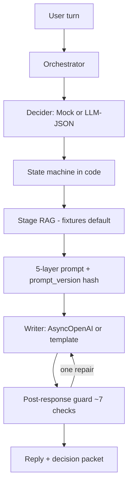

# decide-then-generate

A conversational shop assistant where a **structured Decider chooses** and the **LLM only drafts**.

This repo is a public, fictional portfolio case: a consultative tea counter (**Orvalho Atelier**) with a 10-item synthetic catalog. No real business is modeled here.

A third-party classifier/Decider **or** an LLM-JSON Decider can fill the same typed form. The merit is the architecture: policy counters in code, a writer with no authority, stage RAG with **zero embeddings per turn** on the default path, and a post-response guard.

## Resumo (PT-BR)

Assistente conversacional **decide-then-generate**. Um Decider plugável (mock tipado **ou** LLM com JSON estruturado) responde ~15 campos por turno. Uma máquina de estados em código veta oferta nas 4 primeiras falas, aplica intervalo entre ofertas e força handoff em risco. O modelo de linguagem **só redige**. RAG é por estágio (fixtures; Qdrant é opcional e mockável). Depois da resposta, ~7 checagens e no máximo 1 regeneração. Eval com ouro sintético, checagens duras, juiz mockável e relatório. FastAPI + pytest. Catálogo 100% fictício.

## Architecture



| Layer | Owner | Role |
| --- | --- | --- |
| Decider | mock rules or `json_object` LLM | Fills a typed packet (~17 fields, 15 speech acts) |
| State machine | Python counters | No offer in first 4 turns; min interval; max offers; high-risk handoff |
| RAG | fixtures by `Stage` | Default path never embeds. Qdrant behind a protocol |
| Prompt | 5 layers | Frozen prefix (identity + policy) hashed as `prompt_version` |
| Writer | AsyncOpenAI, no LangChain | Drafts only. Tests/demo use `TemplateWriter` |
| Guard | 7 deterministic checks | One regeneration, then a canned fallback |
| Eval | gold JSON | Hard checks + mockable judge + markdown/JSON report |

## Five-layer prompt

1. **Identity** — writing voice, no strategy
2. **Policy** — catalog grounding, no payment harvest, no medical claims, obey `speech_act`
3. **Retrieved context** — stage chunk + catalog rows
4. **Decision packet** — JSON the writer must render, not revisit
5. **Transcript** — recent turns + current utterance

Layers 1–2 are a **byte-identical prefix** across turns. `prompt_version = sha256(prefix)`. Tests lock that hash.

## Decision packet (typed questions / turn)

`speech_act`, `stage`, `user_intent`, `slots_filled`, `next_slot`, `should_offer`, `should_handoff`, `risk_level`, `risk_codes`, `product_ids`, `objection_type`, `tone`, `rag_stage`, `language`, `confidence`, `reason_codes`, `draft_brief`.

Speech acts: greet, ask_need, ask_occasion, ask_taste, ask_caffeine, ask_budget, ask_experience, educate, recommend, compare, offer, handle_objection, confirm, handoff, close.

The Decider is a **protocol**. Swap `MockDecider` for `LlmJsonDecider` (or a third-party classifier that emits the same schema) without touching the writer.

## Run

```bash
python -m venv .venv && source .venv/bin/activate
pip install -e ".[dev]"
pytest -q
python -m app.eval
uvicorn app.main:app --reload
```

Default stack needs **no API key**: `DECIDER=mock`, `WRITER=template`, `RETRIEVER=fixtures`.

Optional:

```bash
export OPENAI_API_KEY=...
export DECIDER=llm_json
export WRITER=openai
```

Task routing lives in [`models.yaml`](models.yaml) (`decide` / `generate` / `judge`). The critical path uses **AsyncOpenAI directly**. LangChain is not a dependency.

Qdrant is an optional extra (`pip install -e ".[qdrant]"`) behind `Retriever`. Inject a fake client in tests. The chosen demo path does not call an embedder.

## HTTP

- `GET /` — small chat UI
- `GET /health`
- `GET /v1/catalog`
- `GET /v1/schema`
- `POST /v1/chat` `{ "message", "session_id?" }`

Each chat response includes the compact decision, `prompt_version`, and guard report so the split of **decide vs draft** is inspectable.

## Tests

- Prefix bytes identical across turns; version is SHA-256 of that prefix
- State-machine counters (first-4, interval, cap, handoff)
- Mock Decider + LLM-JSON parse/fallback
- Fixture RAG never embeds; Qdrant path mockable
- Seven guard checks + single regeneration
- FastAPI session, no early offer, handoff
- Gold eval with mock judge

## Catalog

Ten fictional SKUs (teas, two tools, two kits) in `fixtures/catalog.json`. Prices and names in replies must come from that file. The shop, the blends, and the dialogues are synthetic.

## What this is not

Not a production checkout. Not a claim about any live brand. Classifier quality is interchangeable; this case is about **control flow**: typed decide, code-level policy, frozen prompt prefix, stage retrieval, then a constrained draft.
